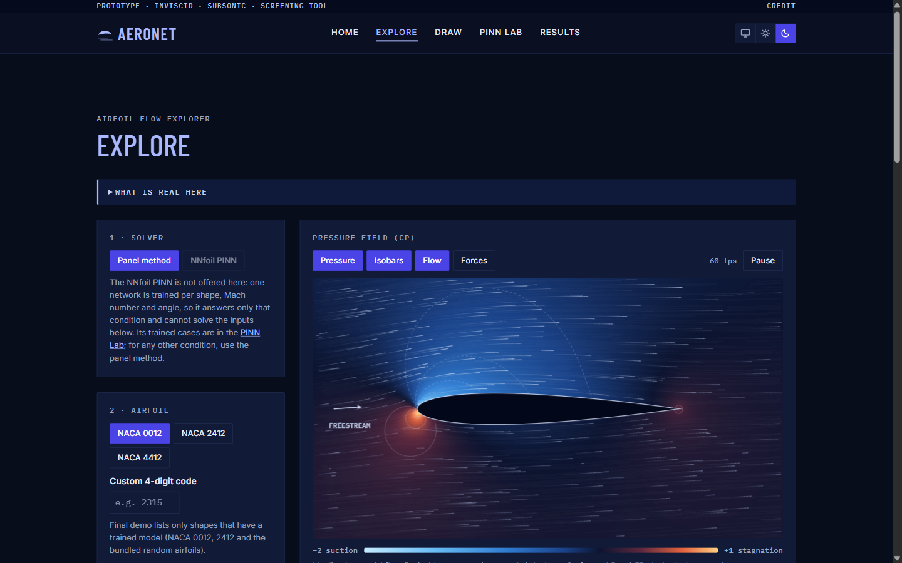

# AeroNet app: React frontend + Python solver backend

The interactive AeroNet demo: explore airfoils, draw any 2D shape, open the trained PINNs in the PINN Lab, and read the evidence on
the Results page. The look follows [`docs/DESIGN_BRIEF.md`](../docs/DESIGN_BRIEF.md) (style only: no third-party logo, text or fonts).



```
Browser (React + Vite)  <--- JSON over HTTP --->  FastAPI (Python)
  Home, Explore, Draw, PINN Lab, Results            panel-method solver (NumPy): any airfoil or closed outline
  canvases, charts, dark mode                       exported PINN results (JSON in backend/data), no PyTorch needed
  offline fallback (saved answers)                  reads nothing from NNfoil/ or results/ at run time
```

The live solver behind the sliders is a **classical panel method** (Hess-Smith with a Prandtl-Glauert Mach correction): real
physics, no neural network. A trained PINN answers only the one condition it was trained for, so the trained networks are shown in the
PINN Lab as exported cases, not behind the sliders.

## Quick start

Requirements: Python 3.10+ (developed on 3.13), Node.js 18+. The first run needs the internet for `npm install` and `pip install`;
after that the app runs offline (fonts are self-hosted).

**One command (Windows):**

```powershell
.\start.ps1
```

Then open http://localhost:8000. The script builds the frontend if `frontend/dist` is missing and creates `backend/.venv` if it is
missing. **`backend/.venv` is optional**: any Python with `backend/requirements.txt` installed works (the backend tests were run on the
system Python 3.13 without a venv).

**Manually:**

```bash
# 1. frontend
cd frontend
npm install
npm run build          # FastAPI serves frontend/dist at /
# 2. backend (venv optional)
cd ../backend
python -m venv .venv
.venv/Scripts/python -m pip install -r requirements.txt     # Linux/macOS: .venv/bin/python
.venv/Scripts/python -m uvicorn aeronet.main:app --port 8000
```

**Development (hot reload):** run the backend as above (add `--reload`), and in another terminal `cd frontend && npm run dev`, then open
http://localhost:5173. Vite proxies `/api` to port 8000.

## Pages and tabs

The site has five pages, chosen by the `#hash` of the address (plain links, so Back, Forward and shared links work). The theme toggle
in the header switches light, dark or system.

| Page | Address | What it does |
|---|---|---|
| Home | `#home` | Live-flow hero, three headline numbers with their sources, links to the other pages |
| Explore | `#explore` | NACA 4-digit airfoils (presets or any code): angle of attack and Mach sliders, pressure field, isobars, animated flow, force arrows, Cp curve, lift polar, pin and compare, optional reference overlay (`NNfoil` FVM sample or an uploaded `*_Cp.dat`), critical-Mach warning and shape optimiser, optional NeuralFoil viscous check |
| Draw | `#draw` | Draw any closed 2D shape with mouse, pen or finger (smoothed, auto-closed, mirror and undo), or pick a library shape (circle, ellipse, teardrop, flat plate, bird wing, sedan, sports car), or import and export a UIUC `.dat`; optional road below the shape (ground effect) |
| PINN Lab | `#pinn` | 14 trained cases (one network each): flow field, wall Cp against the FVM and the panel method, training history, a replay of the training rounds, and the same-mesh showdown card |
| Results | `#results` | Four headline numbers, three findings with charts (mesh study, training trajectory, cylinder), "What did not work", speed and cost cards, and the full numbers dashboard (all rows of `results/summary.csv`, filterable) |

Every number carries a **measured**, **quoted** or **fitted** tag with its source. Car shapes show an "idealized flow" note and never a drag value.

## URL options

| Option | Effect |
|---|---|
| `#home`, `#explore`, `#draw`, `#pinn`, `#results` | open that page (for example `#pinn`, `#results`) |
| `?present` | presenter mode: cycles Explore NACA 0012 and 2412, bird wing, sedan and circle, 8 seconds each, until the first click, key press or scroll; hides the explanatory sections |
| `?light` or `?theme=light` / `?theme=dark` | force a theme for one visit (otherwise the saved choice, or the system setting) |
| `?sample` | open Explore with the bundled FVM reference (NACA 0012, 4 degrees, Mach 0.4) loaded |
| `?pinn=<case id>&round=N` | open the PINN Lab on that case at training round N, for example `?pinn=naca0012_100x50_a4_m04_gs#pinn` (ids from `GET /api/pinn/cases`) |
| `?tab=explore`, `?tab=draw`, `code`, `alpha`, `mach`, `shape`, `lifting`, `ground` | shareable state of the two tool pages (written to the address as you work; freehand outlines are not stored) |

**Deploying** (static demo, one container, or the laptop, and the licence line for a public site): see [`docs/DEPLOY.md`](../docs/DEPLOY.md).

## Tests

```bash
cd backend  && python -m pytest -q        # 153 passed, 2 skipped (NeuralFoil is optional)   [counts of 2026-11-14]
cd frontend && npm test                   # 106 passed
```

The research tests (including the export of PINN cases that feeds this app) are in `research/tests/`, see the root README.

## API

All paths are under one server (`http://localhost:8000`); interactive docs at http://localhost:8000/docs.

| Method and path | Purpose |
|---|---|
| `GET /api/health` | status and version |
| `GET /api/solvers` | solvers: `panel` (available) and `pinn` (listed, with a note: one network per condition) |
| `GET /api/airfoils` | airfoil presets (NACA 0012, 2412, 4412) |
| `POST /api/solve` | one NACA airfoil by the panel method: Cl, Cd, surface Cp, optional Cp field, optional comparison with reference points |
| `POST /api/solve_shape` | the same for a closed outline of any shape (`points`, `lifting`, `ground` gap to the road); returns the shape info and warnings |
| `POST /api/polar` | Cl for a list of angles (a NACA `code` or an outline `points`) |
| `GET /api/shapes` | the shape library (circle, ellipse, teardrop, plate, bird wing, sedan, sports car) |
| `POST /api/shapes/parse_dat` | read the text of a UIUC Selig or Lednicer `.dat` file into an outline |
| `GET /api/pinn/cases` | the trained PINN cases: id, label, shape, mesh, Mach, angle, Cp RMS, Cl, collapsed flag, source |
| `GET /api/pinn/cases/{case_id}` | one case: surface Cp, reference, panel solution, metrics, timing, log, per-round snapshots and the flow field (404 for an unknown id) |
| `GET /api/results` | the rows of `results/summary.csv` as exported, each with its `source` label |
| `GET /api/results/e1_rounds` | round-by-round Cp RMS and Cl of the six E1 runs |
| `GET /api/showdown` | same-mesh FVM against PINN, both against the FVM 800x400 reference |
| `GET /api/tradeoff` | accuracy against cost (seconds on the project laptop) for panel, PINN and FVM |
| `POST /api/optimize` | shape a NACA-family airfoil for the least suction at a target Cl (raises the critical Mach number; inviscid) |
| `POST /api/viscous` | **optional**: NeuralFoil viscous Cl and Cd next to the inviscid result; answers 503 if NeuralFoil is not installed |
| `POST /api/reference/parse` | parse the text of an NNfoil `*_Cp.dat` file into (x/c, y/c, Cp) points |
| `GET /api/reference/sample` | the bundled sample reference plus its condition (0012, 4 degrees, Mach 0.4) |

`POST /api/solve` body: `{ "solver": "panel", "code": "2412", "alpha": 4, "mach": 0.4, "n_half": 70, "grid_width": 170, "reference": [[x, y, cp], ...] }`.
Invalid input (bad NACA code, angle outside -20..20, Mach outside 0..0.7) returns 422.

**`/api/solve` with `solver=pinn` returns 409 by design.** A PINN is trained for one shape, Mach number and angle, so it cannot answer an
arbitrary request, and the app refuses instead of faking an interpolation between cases. Use the PINN Lab (`/api/pinn/cases`).

## How PINN results get into the app

The backend never runs a network. It serves JSON files in `backend/data/`, written from finished training runs by
[`research/export_results.py`](../research/export_results.py):

```bash
research/.venv/Scripts/python research/export_results.py                    # all finished runs, summary and seed files
research/.venv/Scripts/python research/export_results.py --only <run id>    # one case only
```

It writes `data/pinn_cases/<run id>.json` (the case: wall Cp, panel solution, metrics, timing, per-round snapshots and a resampled
flow field), `results_summary.json` (rows of `results/summary.csv`), `seed_runs.json` and `rounds_e1.json`. To add a case: train it
with `NNfoil/run_case.py` (see the root README), add its row to `results/summary.csv` (`research/validate.py`), then run the exporter.
The model weights and `field.npz` files are not committed, so a re-export needs the run folders on the machine that trained them.

## Offline fallback (safe demo mode)

If the backend stops answering while the page is open (a network error, or a server error without a message), the page switches to
saved answers from `frontend/public/cache/bundle.json` and shows a banner with the date they were saved. Presets at their starting
angle and Mach number, the PINN Lab cases kept in the bundle, the charts and the Results page keep working; the sliders, drawing and
new cases need the backend. The bundle is loaded in the background while the backend is up, so open the page once before a talk.
Regenerate it with the backend running:

```bash
cd frontend && node scripts/make-cache.mjs http://localhost:8000
```

## What is optional

- **NeuralFoil** (Peter Sharpe, MIT licence): `pip install -r backend/requirements-viscous.txt` enables `POST /api/viscous` and the viscous check on the Explore page. Without it the endpoint answers 503, the page says so, and the 2 NeuralFoil tests are skipped.
- **PyTorch and `research/.venv`:** only for training and exporting. The app itself does not import torch.
- **`backend/.venv`:** a convenience; see Quick start.

## Project layout

```
app/
  start.ps1               one-command start (Windows)
  backend/
    aeronet/
      geometry.py         NACA 4-digit geometry and code validation
      panel.py            Hess-Smith panel solver (+ Prandtl-Glauert), generic outlines, ground effect
      shapes.py           shape library, outline preparation, UIUC .dat parser
      field.py            Cp and velocity field on a grid
      compare.py          thin-airfoil theory, reference-file parser, RMS/max comparison
      compressibility.py  critical Cp and Mach number warning
      optimize.py         critical-Mach shape optimiser
      neural.py           optional NeuralFoil viscous estimate
      solvers.py          solver registry (panel available; pinn listed, 409 on /api/solve)
      pinn_cases.py       the one loader of exported PINN cases and results
      pinn_data.py        same-mesh showdown;  tradeoff.py  accuracy against cost
      schemas.py          request/response models (pydantic)
      main.py             FastAPI app; serves frontend/dist when built
    data/                 exported PINN cases and results (JSON), bundled FVM sample
    tests/
  frontend/
    src/App.jsx           pages and layout;  api.js  backend client with offline fallback
    src/components/       Hero, Explore cards, DrawSection, PinnLab, ResultsPage, charts, SiteHeader
    src/utils/ hooks/ theme/ offline/    helpers (with tests), solve hooks, light/dark theme, saved answers
    public/cache/bundle.json    saved answers for the offline fallback
    scripts/make-cache.mjs      regenerates the bundle
  docs/                   early screenshots (the current ones are in ../docs/milestones/img/)
```

## Notes

- Scope: inviscid, subsonic flow only. Inviscid theory has no stall, so lift keeps rising at large angles, and the drag shown for a lifting body is numerical error.
- The solver runs on the server, so "Solve time" is the server-side time (the label says so).
- The field is computed in single precision on the server (error about 3e-6 in Cp, invisible in the picture); forces and surface Cp use double precision.
- The bundled reference data is a sample of NNfoil's FVM output (github.com/Cao-WenBo/NNfoil, Cao, Song and Zhang, arXiv 2401.08705; no licence file): shown with the author's permission (given by email; its repository has no licence file), so keep the credit, and see [`docs/DEPLOY.md`](../docs/DEPLOY.md) ("Licence") before publishing the NNfoil source code or data in a repository of your own.
