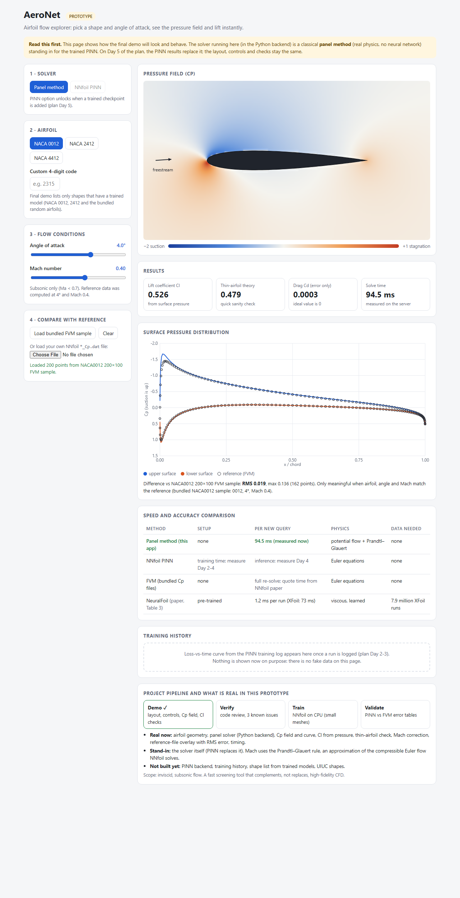

# AeroNet app: React frontend + Python solver backend

The interactive AeroNet demo, rebuilt from the single-file `prototype/` as a proper two-part project.
The design and behaviour are the same as the prototype; the solver now runs in Python.



```
Browser (React + Vite)  <--- JSON over HTTP --->  FastAPI (Python)
  controls, canvases                                 panel-method solver (NumPy)
  colour map, plots                                  Cp field, thin-airfoil check,
                                                     reference-file parsing and comparison
```

The solver is a **classical panel method used as a stand-in for the NNfoil PINN** (real physics, no neural network),
exactly as in the prototype. The API is built so a trained PINN can be added as a second solver without touching the frontend.

## Quick start

Requirements: Python 3.10+ (developed on 3.14), Node.js 18+.

**One command (Windows):**

```powershell
.\start.ps1
```

Then open http://localhost:8000. The script builds the frontend and creates the Python environment on first run.

**Manually:**

```bash
# 1. backend
cd backend
python -m venv .venv
.venv/Scripts/python -m pip install -r requirements.txt     # Linux/macOS: .venv/bin/python
# 2. frontend
cd ../frontend
npm install
npm run build          # FastAPI serves frontend/dist at /
# 3. run
cd ../backend
.venv/Scripts/python -m uvicorn aeronet.main:app --port 8000
```

**Development (hot reload):** run the backend as above (add `--reload`), and in another terminal `cd frontend && npm run dev`,
then open http://localhost:5173. Vite proxies `/api` to port 8000.

Page options (same as the prototype): `?sample` opens with the bundled FVM reference loaded; `?theme=light` or `?theme=dark` forces a colour
theme for one visit (`?light` still works).

**Deploying** (static demo, one container, or the laptop, and the licence line for a public site): see [`docs/DEPLOY.md`](../docs/DEPLOY.md).

## Tests

```bash
cd backend  && .venv/Scripts/python -m pytest     # 29 tests: solver, comparison, field, API
cd frontend && npm test                           # 7 tests: colour map, NACA code validation
```

The backend tests include the prototype's nine solver sanity tests and parity checks against the JavaScript results.
The Python solver was also compared with `prototype/solver.js` on 48 airfoil / angle / Mach combinations: lift, drag, thin-airfoil Cl,
surface Cp and field Cp agree to about 1e-13.

## Project layout

```
app/
  backend/
    aeronet/
      geometry.py    NACA 4-digit geometry and code validation
      panel.py       Hess-Smith panel solver (+ Prandtl-Glauert Mach correction)
      field.py       Cp field on a grid, point-in-body test (vectorised, multi-threaded)
      compare.py     thin-airfoil theory, reference-file parser, RMS/max comparison
      solvers.py     solver registry (panel available, pinn listed as not yet available)
      schemas.py     request/response models (pydantic)
      main.py        FastAPI app; serves frontend/dist when built
    data/            bundled sample of NNfoil's NACA 0012 (200x100) FVM reference data
    tests/
  frontend/
    src/
      App.jsx                 state and layout
      api.js                  backend client
      hooks/useSolve.js       quick low-res request, then full-res after 180 ms; aborts stale requests
      hooks/useCanvasDraw.js  sharp canvases at any size / pixel ratio
      components/             ControlCards, FieldCard, CpCard, InfoCards
      utils/                  colormap.js, naca.js (+ tests)
      styles.css              the prototype's CSS, unchanged
  docs/                       screenshots
```

## API

| Method and path | Purpose |
|---|---|
| `GET /api/health` | status and version |
| `GET /api/solvers` | available solvers (`panel`, and `pinn` marked unavailable with a note) |
| `GET /api/airfoils` | airfoil presets |
| `POST /api/solve` | solve one case; optionally returns the Cp field and a comparison with reference points |
| `POST /api/reference/parse` | parse the text of an NNfoil `*_Cp.dat` file into (x/c, y/c, Cp) points |
| `GET /api/reference/sample` | bundled sample reference plus its condition (0012, 4 degrees, Mach 0.4) |

`POST /api/solve` body: `{ "solver": "panel", "code": "2412", "alpha": 4, "mach": 0.4, "n_half": 70, "grid_width": 170, "reference": [[x, y, cp], ...] }`.
Invalid input (bad NACA code, angle outside -20..20, Mach outside 0..0.7) returns 422; an unavailable solver returns 409.
Interactive docs: http://localhost:8000/docs.

## Adding the trained PINN later

1. Export the PINN's surface Cp, Cl and field to a small module that returns an object like `PanelSolution` (`aeronet/panel.py`).
2. In `aeronet/solvers.py` set `pinn` to `available=True` with its `solve` function.
3. The frontend already reads `/api/solvers`; the PINN button will unlock with no frontend change.

## Differences from the prototype

- The solver runs on the server, so **Solve time** shows the server-side time (the label says so).
- The panel method and the reference-file parser are Python (NumPy). The colour map, canvases and layout are React.
- The field is computed in single precision on the server (error about 3e-6 in Cp, invisible in the picture); forces and surface Cp use double precision.
- The prototype's text mentions the Python backend; everything else (cards, controls, wording, colours) is unchanged.

## Notes

- Scope: inviscid, subsonic flow only. Inviscid theory has no stall, so lift keeps rising at large angles.
- The bundled reference data is a sample of NNfoil's FVM output (github.com/Cao-WenBo/NNfoil, no licence file); keep the credit if you share it.
