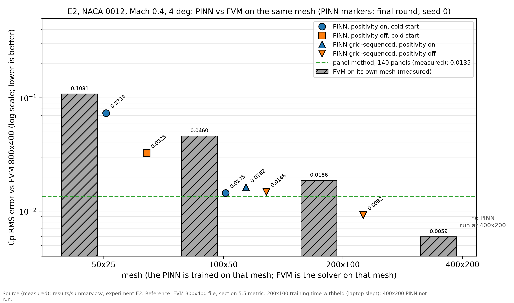
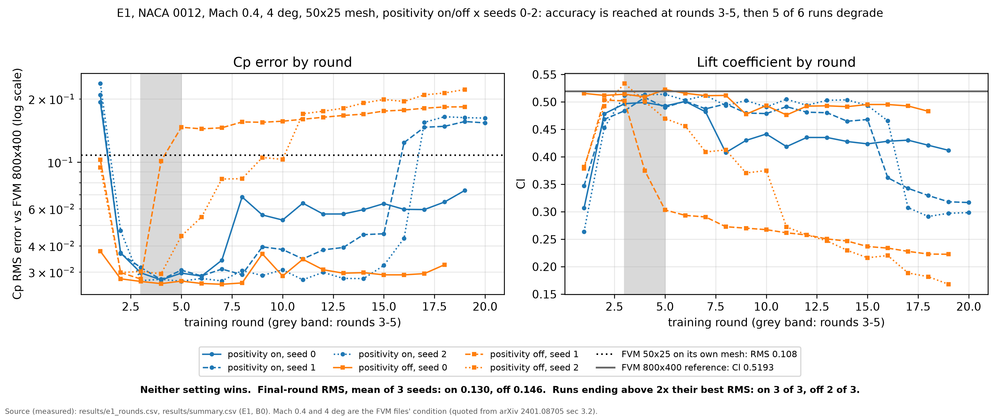
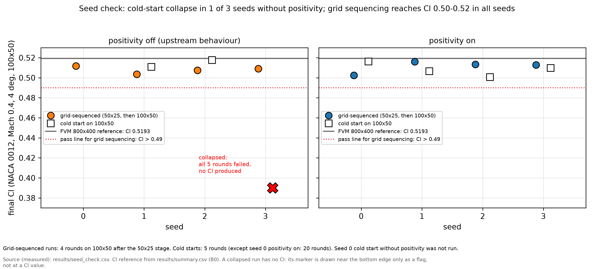
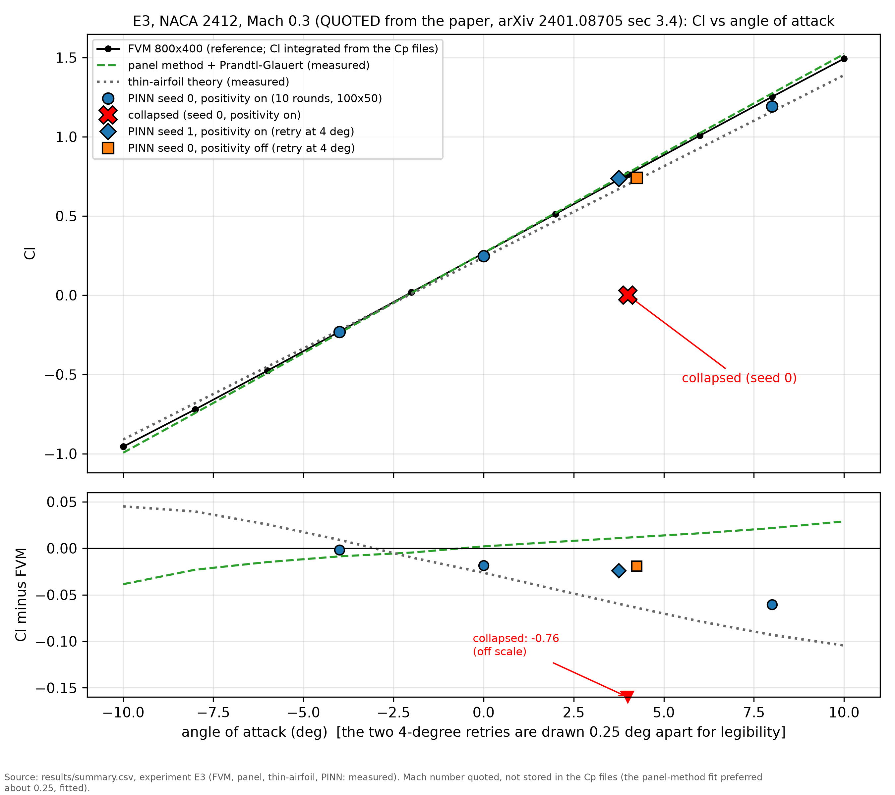
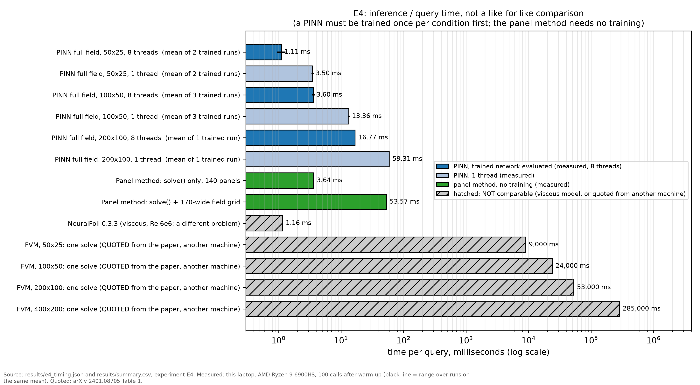
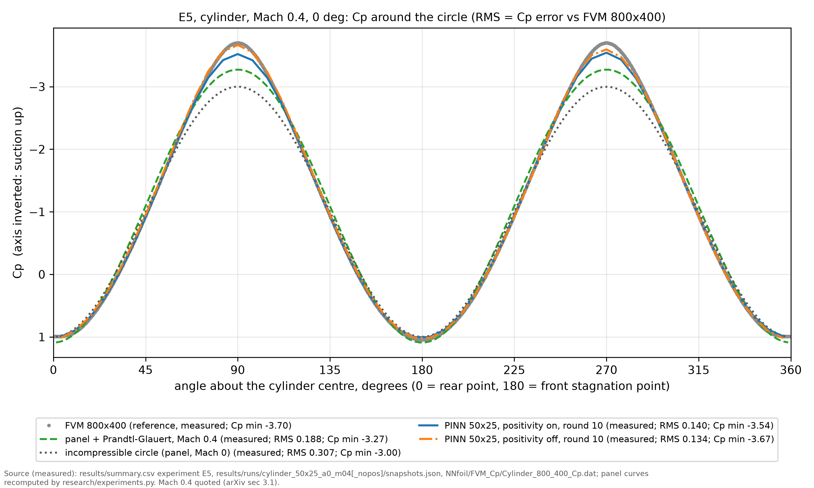
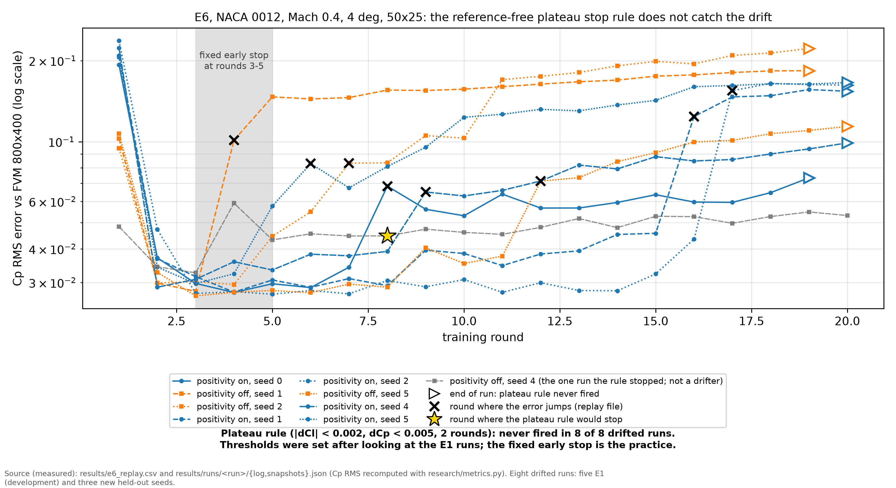

# Milestone 3: PINN results (research half)

> **Update (2026-11-14, after the merge into `main`):** the app half described as pending below now exists: the PINN Lab (14 exported cases, training replay), the numbers dashboard and the redesigned Results page are in `app/` (see [`app/README.md`](../../app/README.md)). Sections 10 and the last section are kept as written at the time; the ablations (C11) and training on a drawn shape (C10) are still not done.

Status: **research half complete (2026-11-14); the app half is pending** (PINN Lab, train-on-your-shape and the ablations are not done, section 10). Branch `plan-c-pinn-results`. Every number below comes from a file in `results/`: `summary.csv` (S), `e1_rounds.csv`, `e4_timing.json` and `e4_speed.md` (E4), `e6_replay.csv` and `e6_stop_rule.md` (E6), `seed_check.csv`, `drift_step1.csv`, or a run folder's `log.json` and `snapshots.json` (R). The tables in this document are printed by `research/report_tables.py` and the figures by `research/make_figures.py`, so none of them is typed by hand. Labels: **measured** = produced by code in this repo on this laptop; **quoted** = copied from the paper (arXiv 2401.08705, Cao, Song and Zhang) or another document and not re-run here; **fitted** = tuned to data. A number with no label is measured.

Common setting unless a section says otherwise: NNfoil (their PINN Euler solver, vendored and fixed in Milestone 1, [`M1-nnfoil-verified.md`](M1-nnfoil-verified.md)), NACA 0012, Mach 0.4, 4 degrees (the condition of the bundled FVM files, quoted from the paper section 3.2), network 5x128, L-BFGS, 8 CPU threads on an AMD Ryzen 9 6900HS laptop. The reference is always the FVM 800x400 file; the Cp error is the section 5.5 metric (`research/metrics.py::cp_error`: RMS over the nearest predicted surface point of every reference point with 0.02 <= x/c <= 0.98). PINN rows are the **final round** of each run unless stated.

## 1. What this milestone shows

1. **On a sparse mesh the PINN is more accurate than the finite-volume solver (FVM) on the same mesh, in every mesh we trained.** Against FVM 800x400, Cp RMS is 0.0325 to 0.0734 (50x25, final round) against 0.1081 for FVM; 0.0145 to 0.0162 (100x50) against 0.0460; and 0.0092 (200x100) against 0.0186. One seed per cell, so this is a measured result, not yet a statistical one (sections 2 and 4).
2. **The training is not stable at 50x25, and the loss does not tell you.** At round 3 all six E1 runs are at Cp RMS 0.027-0.032, then 5 of 6 degrade (final RMS up to 0.222) while the loss keeps falling; the loss is negatively rank-correlated with the error. Positivity on or off makes no consistent difference: **neither mode wins** (section 3).
3. **Grid sequencing is reliable where a cold start is not.** Training on 50x25 and moving the weights to 100x50 gave Cl 0.502 to 0.516 in all 8 runs (seeds 0-3, both positivity modes). A cold 100x50 start without positivity collapsed in 1 of 3 seeds (all rounds failed); with positivity 0 of 4 collapsed (section 5). A cold NACA 2412 run with positivity collapsed anyway (section 6).
4. **Other conditions: NACA 2412 at Mach 0.3 (quoted) and the cylinder.** The PINN's Cl is within 0.002 to 0.060 of the FVM at four angles of attack, not better than the panel method there; on the cylinder the PINN (Cp RMS 0.134-0.140) beats the panel method with Prandtl-Glauert (0.188), not the FVM at 200x100 (0.079) (sections 6 and 8).
5. **Speed is not a PINN win, and the stop rule failed.** Evaluating a trained network on a whole 50x25 field takes 1.27 ms (8 threads), a panel solve 3.64 ms: the network answers one condition and must be retrained for any other (section 7, not a like-for-like comparison). A reference-free plateau stop rule stopped 0 of 8 drifted runs; the practice is a fixed early stop at round 3-5 (section 9).

## 2. Headline table (NACA 0012, Mach 0.4, 4 deg; S, experiment E2 and B0)

| Method | Mesh | Rounds (failed) | Cl | Cl error | Cp RMS | Cp max error | Train s | Source |
|---|---|---|---|---|---|---|---|---|
| FVM | 50x25 | - | 0.4265 | -17.9% | 0.1081 | 0.722 | - | measured |
| FVM | 100x50 | - | 0.4803 | -7.5% | 0.0460 | 0.261 | - | measured |
| FVM | 200x100 | - | 0.5046 | -2.8% | 0.0186 | 0.113 | - | measured |
| FVM | 400x200 | - | 0.5146 | -0.9% | 0.0059 | 0.037 | - | measured |
| Panel method (Hess-Smith + Prandtl-Glauert) | 140 panels | - | 0.5261 | +1.3% | 0.0135 | 0.090 | - | measured |
| Panel method (Hess-Smith + Prandtl-Glauert) (B0 baseline) | 200 panels | - | 0.5262 | +1.3% | 0.0099 | 0.071 | - | measured |
| Thin-airfoil theory (PG corrected) | - | - | 0.4786 | -7.8% | - | - | - | measured |
| PINN, positivity on | 50x25 | 19 (1) | 0.4119 | -20.7% | 0.0734 | 0.213 | 334.2 | measured |
| PINN, positivity off | 50x25 | 18 (2) | 0.4829 | -7.0% | 0.0325 | 0.146 | 416.2 | measured |
| PINN cold start, positivity on | 100x50 | 20 (0) | 0.5163 | -0.6% | 0.0145 | 0.083 | 577.6 | measured |
| PINN grid-seq., positivity on | 100x50 | 4 (0) | 0.5024 | -3.3% | 0.0162 | 0.083 | 121.1 | measured |
| PINN grid-seq., positivity off | 100x50 | 4 (0) | 0.5117 | -1.5% | 0.0148 | 0.086 | 143.9 | measured |
| PINN grid-seq., positivity off | 200x100 | 20 (0) | 0.5118 | -1.4% | 0.0092 | 0.035 | withheld (laptop slept) | measured |

Cl reference 0.5193 (FVM 800x400, integrated from the ordered Cp file, `metrics.fvm_forces`). "Rounds (failed)" counts good rounds and, in brackets, rounds the optimiser restarted (taken from the `rounds=` note of each row). Train s is the wall time of the run (8 threads, idle CPU); grid-sequenced rows count their own stage only and **exclude the parent run** that supplied the weights (for the 100x50 rows, the 50x25 run of the same positivity mode; for 200x100, the 100x50 grid-sequenced run). The panel method appears twice because the two rows use a different number of panels (E2: 140 panels, RMS 0.0135; B0 baseline: 200 panels, RMS 0.0099); both are measured. The 200x100 run's training time is **withheld**: the laptop slept during it (one logged round spans about 34,000 s), so its wall time is not usable. There is no PINN at 400x200.



## 3. E1: positivity on or off, the honest finding (measured; S, `results/e1_rounds.csv`)

Design: 50x25, seeds 0-2, positivity on (softplus plus 1e-3 on p and rho) and off (upstream behaviour), up to 20 attempted rounds each.

| Positivity | Seed | Rounds (failed) | RMS r3 | RMS r4 | RMS r5 | RMS final | RMS worst round | Cl final | Train s |
|---|---|---|---|---|---|---|---|---|---|
| on | 0 | 19 (1) | 0.030 | 0.028 | 0.030 | 0.073 | 0.193 | 0.412 | 334.2 |
| on | 1 | 20 (0) | 0.032 | 0.028 | 0.031 | 0.154 | 0.209 | 0.317 | 451.6 |
| on | 2 | 20 (0) | 0.027 | 0.028 | 0.027 | 0.162 | 0.237 | 0.298 | 342.9 |
| off | 0 | 18 (2) | 0.027 | 0.026 | 0.027 | 0.033 | 0.038 | 0.483 | 416.2 |
| off | 1 | 19 (1) | 0.028 | 0.101 | 0.147 | 0.183 | 0.183 | 0.223 | 289.0 |
| off | 2 | 19 (1) | 0.030 | 0.029 | 0.045 | 0.222 | 0.222 | 0.168 | 310.6 |

- **Accuracy is reached early.** At round 3 the Cp RMS is 0.027-0.032 in all six runs, about 4x better than the FVM 50x25 on its own mesh (0.108). Rounds 4 and 5 are not safe in every run: positivity off, seed 1 is already at 0.101 in round 4 and 0.147 in round 5.
- **Then 5 of 6 runs degrade** (final RMS more than 2x the best round): positivity on, seeds 0, 1, 2 (final 0.073, 0.154, 0.162, with the jump at round 8, 16 and 17) and positivity off, seeds 1 and 2 (0.183, 0.222, jumps at rounds 4 and 7; `results/e6_replay.csv`). Only positivity off, seed 0 stayed good (final 0.033). Final Cl falls to 0.168-0.412 against the reference 0.5193.
- **Neither mode wins.** Mean final RMS is 0.130 with positivity and 0.146 without; 3 of 3 runs degrade with it and 2 of 3 without. The earlier conclusion "positivity hurts" came from the lucky positivity-off seed 0 and is withdrawn (roadmap 8h). Positivity only changes when the jump happens.
- **The loss is not a usable stopping criterion.** Over all rounds, the Spearman rank correlation between the total loss and the Cp RMS is negative in the five degrading runs, -0.48 to -0.98 (`results/drift_step1.csv`, column `rho_all`: -0.63, -0.60, -0.48 for positivity on seeds 0-2; -0.98 and -0.91 for positivity off seeds 1 and 2), and -0.89 to -0.99 over the rounds from the best round onward (`rho_drift`). In the run that stayed good it is -0.09. So a lower loss goes with a worse answer: the Euler residual does not pin the circulation (nothing enforces a Kutta condition), which is the suspected cause, not a tested one. Caveat: rounds inside one run are not independent samples; this describes the shape of each run, not a test.



## 4. E2: mesh study, PINN against FVM on the same mesh (measured)

The PINN beats the FVM on the same mesh at 50x25, 100x50 and 200x100 (table in section 2, figure above). The PINN is not imitating the coarse FVM: its Cp differs from the same-mesh FVM by RMS 0.0935 and 0.1074 at 50x25 and 0.0568 to 0.0620 at 100x50 (E2b rows of S), about the FVM's own distance to the reference.

- 50x25: 0.0734 (positivity on) and 0.0325 (off) against FVM 0.1081. These are single seed-0 runs; section 3 shows how much seeds matter at this mesh.
- 100x50: cold start 0.0145 (20 rounds), grid-sequenced 0.0162 and 0.0148 (4 rounds each), against FVM 0.0460.
- 200x100: 0.0092 against FVM 0.0186, positivity off, chained 50x25 -> 100x50 -> 200x100 (Cl 0.5309 right after the last transfer, 0.5118 at the end, 20 of 20 planned rounds attempted; `config.json` says 30 because `--resume` added 10 rounds to a 20-round plan after only 10 had run). **Its training time is withheld** (laptop slept). This is one run; its best round by Cp RMS is 0.0089 (round 13, post-hoc: chosen with the FVM error).
- 400x200: no PINN run. The FVM there is already at 0.0059.
- Against the panel method (0.0135 at 140 panels, 0.0099 at 200): the PINN is about as accurate at 100x50 (0.0145 to 0.0162), worse at 50x25, and better at 200x100 (0.0092) than the 140-panel row and level with the 200-panel row. So on this smooth case the PINN's accuracy is not a reason to prefer it over a good panel method; what it offers is that it solves the Euler equations without the Prandtl-Glauert assumption (our interpretation, not tested here).

## 5. Grid sequencing and the seed check (measured; `results/seed_check.csv`)

Grid sequencing is our addition, not in the paper: train on 50x25, move the weights to 100x50 with rescaled input normalisation, and continue 4 rounds. Seed check: seeds 0-3 (seed 0 is the earlier single run), both positivity modes, NACA 0012 at Mach 0.4 and 4 deg, 100x50; final Cl against 0.5193 and Cp RMS against FVM 800x400.

| Positivity | Method | Seed 0 | Seed 1 | Seed 2 | Seed 3 |
|---|---|---|---|---|---|
| off | grid-sequenced | Cl 0.512 (RMS 0.0148) | Cl 0.504 (RMS 0.0162) | Cl 0.507 (RMS 0.0154) | Cl 0.509 (RMS 0.0147) |
| off | cold start | not run | Cl 0.511 (RMS 0.0148), 1 failed round | Cl 0.518 (RMS 0.0152), 1 failed round | **collapsed: all 5 rounds failed** |
| on | grid-sequenced | Cl 0.502 (RMS 0.0162) | Cl 0.516 (RMS 0.0145) | Cl 0.513 (RMS 0.0146) | Cl 0.513 (RMS 0.0151) |
| on | cold start | Cl 0.516 (RMS 0.0145), 20 rounds | Cl 0.507 (RMS 0.0154) | Cl 0.501 (RMS 0.0165) | Cl 0.510 (RMS 0.0145) |

- **Grid sequencing: Cl 0.502 to 0.516 in all 8 runs** (the pass line set in advance was Cl > 0.49), Cp RMS 0.0145 to 0.0162.
- **Cold start: 1 of 3 collapsed without positivity** (seed 3, all 5 rounds failed, no Cl produced); **0 of 4 with positivity** (seeds 0-3). The collapse is real but unreliable, and positivity's apparent protection here is only 4 runs; section 6 shows a positivity-on cold start can collapse too.
- No speed advantage is claimed: the coarse stage costs a full 50x25 run (the table in section 2 excludes it). Wall times of the seed-check runs are not quoted (some were stalled by the machine; one first round took 1536 s, per Milestone 1).



## 6. E3: NACA 2412 at Mach 0.3 (the Mach number is **quoted** from the paper section 3.4)

The Mach number is not stored in the Cp files. The paper's parametric NACA 2412 case is Ma 0.3 for alpha in [-10, 10] degrees (quoted, `docs/verification.md`, "Reference data conditions"); our panel-method fit of the files preferred about 0.25 (**fitted**; RMS 0.0121 at 0.25 against 0.0142 at 0.3 for the 4-degree file, within what a Prandtl-Glauert panel method can resolve; those two figures are quoted from `verification.md`). Every E3 row uses 0.3. The panel method in E3 uses 140 panels, so its 4-degree RMS reads 0.0152 here rather than 0.0142.

PINN runs: 100x50 mesh built here from the bundled 200x100 wall (`results/meshes/NACA2412_100_50.x`), cold start, 10 attempted rounds, positivity on, seed 0, at -4, 0, 4 and 8 degrees. FVM, panel and thin-airfoil values are measured (computed here); the Cl differences are prediction minus FVM.

| alpha (deg) | FVM 800x400 Cl | Panel Cl (diff) | Thin-airfoil Cl (diff) | PINN run | PINN Cl (diff) | PINN Cp RMS | PINN train s |
|---|---|---|---|---|---|---|---|
| -10 | -0.9558 | -0.9944 (-0.039) | -0.9108 (+0.045) | - | - | - | - |
| -8 | -0.7204 | -0.7434 (-0.023) | -0.6809 (+0.039) | - | - | - | - |
| -6 | -0.4766 | -0.4914 (-0.015) | -0.4510 (+0.026) | - | - | - | - |
| -4 | -0.2301 | -0.2388 (-0.009) | -0.2210 (+0.009) | seed 0, positivity on | -0.2318 (-0.002) | 0.0195 | 631.6 |
| -2 | 0.0188 | 0.0141 (-0.005) | 0.0089 (-0.010) | - | - | - | - |
| 0 | 0.2651 | 0.2671 (+0.002) | 0.2388 (-0.026) | seed 0, positivity on | 0.2468 (-0.018) | 0.0157 | 714.0 |
| 2 | 0.5130 | 0.5198 (+0.007) | 0.4687 (-0.044) | - | - | - | - |
| 4 | 0.7605 | 0.7720 (+0.011) | 0.6986 (-0.062) | seed 0, positivity on | **0.0000 collapsed** (-0.760) | 15.64 (collapsed) | 44.5 |
| 4 | 0.7605 | 0.7720 (+0.011) | 0.6986 (-0.062) | seed 1, positivity on | 0.7364 (-0.024) | 0.0194 | 687.2 |
| 4 | 0.7605 | 0.7720 (+0.011) | 0.6986 (-0.062) | seed 0, positivity off | 0.7412 (-0.019) | 0.0171 | 685.9 |
| 6 | 1.0071 | 1.0232 (+0.016) | 0.9285 (-0.079) | - | - | - | - |
| 8 | 1.2516 | 1.2732 (+0.022) | 1.1585 (-0.093) | seed 0, positivity on | 1.1912 (-0.060) | 0.0439 | 1027.9 |
| 10 | 1.4929 | 1.5217 (+0.029) | 1.3884 (-0.105) | - | - | - | - |

- **The 4-degree seed-0 run collapsed** to the trivial solution (Cl -6e-8, about 0; 3 good rounds, 7 restarts, 44.5 s; Cp RMS 15.6). It is **not** an E1 verdict: it shows a cold start with positivity on can collapse, which the NACA 0012 seed check (0 of 4) did not.
- **Two retries at 4 degrees**, both fine: seed 1 with positivity on (Cl 0.7364, RMS 0.0194, 687 s) and seed 0 with positivity off (Cl 0.7412, RMS 0.0171, 686 s). The retries were chosen because the first run collapsed.
- **Accuracy where it worked:** Cl differs from the FVM by -0.002 (-4 deg), -0.018 (0 deg), -0.024 and -0.019 (the 4-degree retries) and -0.060 (8 deg); Cp RMS 0.0157 to 0.0439, worst at 8 degrees. At the same four angles the panel method's Cl differs by -0.009 to +0.022 and its Cp RMS is 0.0131 to 0.0235. **So the PINN is not better than the panel method on this case.**
- Not run: other angles, a parametric network (the paper trains one network over alpha, 1543 s, quoted), and the random airfoils.



## 7. E4: speed (measured and quoted, **not a like-for-like comparison**)

Condition: NACA 0012, 4 deg, Ma 0.4. Hardware: AMD Ryzen 9 6900HS (16 logical threads), Windows 11, Python 3.13.7, torch 2.15.0+cpu, neuralfoil 0.3.3. Every timing is the mean of 100 calls after 10 untimed warm-up calls, one timing block at a time, nothing else running (CPU load before each block at most 16%). Full source and caveats: `results/e4_speed.md`.

| What is timed | Mesh | 1 thread, ms | 8 threads (or default), ms | Wall only, 8 threads, ms | Source |
|---|---|---|---|---|---|
| PINN, positivity on: full field | 50x25 | 3.57 | 1.27 | 0.84 | measured |
| PINN, positivity off: full field | 50x25 | 3.43 | 0.96 | 0.69 | measured |
| PINN, positivity on: full field | 100x50 | 13.42 | 3.75 | 0.88 | measured |
| PINN grid-seq., positivity on: full field | 100x50 | 13.50 | 3.48 | 0.89 | measured |
| PINN grid-seq., positivity off: full field | 100x50 | 13.16 | 3.56 | 0.76 | measured |
| PINN grid-seq., positivity off: full field | 200x100 | 59.31 | 16.77 | 0.95 | measured |
| Panel method: solve() | 140 panels | n/a | 3.64 | - | measured |
| Panel method: solve() + 170-wide field grid | 140 panels | n/a | 53.6 | - | measured |
| NeuralFoil 0.3.3 (viscous, Re 6e6: not comparable) | large | n/a | 1.16 | - | measured |
| FVM solve (another machine, quoted from the paper) | 50x25 | n/a | 9,000 | - | quoted |
| FVM solve (another machine, quoted from the paper) | 100x50 | n/a | 24,000 | - | quoted |
| FVM solve (another machine, quoted from the paper) | 200x100 | n/a | 53,000 | - | quoted |
| FVM solve (another machine, quoted from the paper) | 400x200 | n/a | 285,000 | - | quoted |

What is **measured**: the PINN rows are one forward pass of an already trained network over every mesh node (u, v, p, rho everywhere); "wall only" is the Cp, Cl and Cd on the surface. The panel rows are the Hess-Smith solve (plus the 170-wide Cp field grid in the second row); the first includes building the geometry and has a large spread (sd 1.71 ms, max 18.0 ms). NeuralFoil is 1.16 ms per call including its Kulfan fit.

What is **quoted**: the four FVM times are one solve each from Table 1 of the paper, run by its authors on another machine; the paper itself says the table is "not meant as a rigorous comparison". The paper's NNfoil training times (384, 266, 262 and 271 s) are also quoted, not re-measured.

What is **not comparable**:

- A PINN is trained for ONE shape, Mach number and angle. The milliseconds above are a lookup of that one condition; a new condition means retraining, at the training times in section 2 (334 to 578 s per NACA 0012 run on this laptop; 632 to 1028 s for the 10-round NACA 2412 runs).
- The panel method needs no training and is a few milliseconds per new condition; it is inviscid and linear (Prandtl-Glauert).
- NeuralFoil solves a different problem (viscous, Re 6e6, incompressible; Cl 0.4207, not comparable with the inviscid 0.5193). Only its time is shown.
- No fair-speed claim is made beyond what is measured: accuracy at equal cost is E2's question. CPU only, no GPU, one laptop.



## 8. E5: the cylinder (measured; Mach 0.4 and 0 deg quoted from the paper section 3.1, confirmed by the stagnation point at 180 deg and its Cp 1.044)

50x25 O-grid (built here, `results/meshes/Cylinder_50_25.x`), 10 rounds, seed 0, both positivity modes.

| Method | Mesh | Cp RMS | Cp max error | Cp min | Cp at stagnation | Source |
|---|---|---|---|---|---|---|
| PINN, positivity on, 10 rounds | 50x25 | 0.1403 | 0.297 | -3.54 | 1.00 | measured |
| PINN, positivity off, 10 rounds | 50x25 | 0.1337 | 0.302 | -3.67 | 1.02 | measured |
| Panel + Prandtl-Glauert (Mach 0.4) | 140 panels | 0.1877 | 0.428 | -3.27 | 1.09 | measured |
| Incompressible circle (panel, Mach 0) | 140 panels (Ma 0) | 0.3072 | 0.702 | -3.00 | 1.00 | measured |
| FVM | 50x25 | 1.0669 | 2.053 | -2.16 | 1.02 | measured |
| FVM | 100x50 | 0.2663 | 0.527 | -3.34 | 1.02 | measured |
| FVM | 200x100 | 0.0790 | 0.153 | -3.60 | 1.04 | measured |
| FVM | 400x200 | 0.0182 | 0.030 | -3.67 | 1.04 | measured |
| FVM (the reference) | 800x400 | - | - | -3.70 | 1.04 | measured |

- **Corrected panel+PG number:** the panel method with Prandtl-Glauert has Cp RMS **0.188** against FVM 800x400. The earlier figure "about 0.30" was the **incompressible circle** (Mach 0, RMS 0.307), not the Prandtl-Glauert one.
- The PINN (0.134 to 0.140) beats panel+PG by a modest margin and sits close to the FVM at the suction peak (Cp min -3.67 and -3.54 against -3.70; panel+PG -3.27, incompressible -3.00). It beats the FVM on its own 50x25 (1.067) and 100x50 (0.266) meshes on this metric, but **not the FVM at 200x100 (0.079)**.
- The exact Cl of a symmetric cylinder is 0. The PINN's Cl is -0.0044 (positivity on) and 0.0418 (off): the off run carries a small spurious circulation.
- One seed per mode. Round 10 is the final round (the best rounds by RMS were 10 and 6, post-hoc).



## 9. E6: the stop rule is a negative result; the practice is a fixed early stop (measured; `results/e6_stop_rule.md`)

Question: can a rule that does not use the FVM reference stop training near the good answer? The rule: stop when |dCl| < 0.002 and the wall-Cp RMS change < 0.005 for 2 rounds in a row. The thresholds were set after looking at E1 (the **development** set, no claim); they were not changed afterwards. Judged on 15 held-out runs (six brand-new 50x25 seeds 3-5 with 20 attempts each, plus the cylinder, NACA 2412, 100x50 and 200x100 runs), replayed with the same functions the training script uses.

| Group | Runs | Drifted (final RMS > 2x best) | Drifted runs the rule stopped | Rule stopped | Never stopped | Bad stops (> 1.5x best) | Mean best-round RMS (post-hoc) |
|---|---|---|---|---|---|---|---|
| DEVELOPMENT: E1 runs (thresholds were set after looking at them) | 6 | 5 | 0 of 5 | 0 | 6 | 0 of 0 | 0.0276 |
| HELD-OUT: six new 50x25 seeds | 6 | 3 | 0 of 3 | 1 | 5 | 0 of 1 | 0.0286 |
| HELD-OUT: other finished runs (cylinder, NACA 2412, 100x50, 200x100) | 9 | 0 | 0 of 0 | 3 | 6 | 0 of 3 | 0.0457 |
| HELD-OUT, all | 15 | 3 | 0 of 3 | 4 | 11 | 0 of 4 | 0.0388 |

- **0 of 8 drifted 50x25 runs were stopped** (0 of 5 development, 0 of 3 held-out). In the three held-out runs that drifted (positivity on seeds 4 and 5, jumps at rounds 9 and 6; positivity off seed 5, round 12) the final RMS is 3.4x to 5.6x the best, and the closest approach to the rule anywhere in a run was 1.64 to 2.39 (the rule fires below 1): the changes never stay under the thresholds two rounds in a row.
- The rule fired in 4 of 15 held-out runs, all non-drifting (100x50, 200x100, NACA 2412 at 0 deg, one mildly rising 50x25 run), with 0 bad stops, saving 322.9 s of valid timing in total: harmless, not useful. An online run (seed 3, positivity on) was cut off after 12 of 20 attempts without firing; its numbers match the replay to 4 decimals, but that seed does not drift, so it tests nothing. It is inconclusive, and the one stop the replay found has no online test.
- **What works as a practice is a fixed early stop.** Cp RMS if training were stopped at a fixed round, on the 12 50x25 runs of E1 and E6:

| Group | Runs | Round 3 | Round 4 | Round 5 | Final round |
|---|---|---|---|---|---|
| E1 runs (development) | 6 | 0.027-0.032 (mean 0.029) | 0.026-0.101 (mean 0.040) | 0.027-0.147 (mean 0.051) | 0.033-0.222 (mean 0.138) |
| six new seeds (held-out) | 6 | 0.027-0.033 (mean 0.030) | 0.027-0.059 (mean 0.035) | 0.027-0.058 (mean 0.036) | 0.029-0.166 (mean 0.083) |

  The round number comes from E1 (a recipe derived on the development set and checked on six held-out seeds), not tuned on the new seeds. It is **not risk-free**: on E1, round 4 already had a run at 0.101 and round 5 one at 0.147. Not tested on other meshes or shapes. The demo and report should stop at round 3-5 and show the whole trajectory; a real fix for the circulation drift is open (section 10).



## 10. What is NOT done

- **PINN Lab (app): pending.** The app has no PINN Lab yet (tasks C6-C8: export of runs to case JSON, backend, frontend). The showdown's stopgap loader `app/backend/aeronet/pinn_data.py` is still what the app uses. No screenshot exists.
- **Train a PINN on your drawn shape (C10): not started.**
- **Ablations (C11): not started.** The robust loop, periodic input, hard far-field input and a panel-method prior are the only candidate fixes for the drift in section 3; none has been tried, so the drift has **no remedy** yet beyond the fixed early stop.
- **No 400x200 PINN.** The 200x100 PINN training time is withheld.
- **Random airfoils not run.** Their conditions are known from the paper (Table 2, quoted in `docs/verification.md`) but no training was done.
- **Parametric angle of attack not done:** each angle is a separate network.
- E3 covers four angles with one seed each (plus the retries); the seed spread of E3 is unknown. The NACA 2412 Mach number is quoted, not confirmed by us.
- Plan D (README, report, slides) is not started.

## 11. Limits

- Most cells are a single seed. The seed check (4 seeds) and E1/E6 (6 and 6 seeds at 50x25) are the only places with replication, and there the spread is large.
- The reference is itself an FVM result (800x400); the panel method agrees with it to RMS 0.0099, which is the best check we have.
- The Cp RMS is a nearest-point metric, slightly harsher than interpolating along the surface; it is applied identically to every method.
- The drift regime was studied on one case family (NACA 0012, 4 deg, Mach 0.4, 50x25). Other meshes and shapes mostly did not drift, so the stop-rule evaluation cannot test its main job there.
- All timings are one laptop CPU, PyTorch, no GPU. Several training times are wall-clock on a machine that is also used for other work; only idle, awake runs are quoted.
- Mach 0.3 (NACA 2412), Mach 0.4 and 0 deg (cylinder) and the FVM times are quoted from the paper.
- Everything here is inviscid (Euler): no separation, no drag from friction.

## 12. How to reproduce

From the repo root (Windows; `research/.venv` holds torch, numpy, matplotlib, neuralfoil):

```
research/.venv/Scripts/python research/experiments.py commands e1     # prints the training lines; likewise e2, e3, e5
research/.venv/Scripts/python research/experiments.py collect e1      # finished runs -> results/summary.csv (e1, e2, e3, e4, e5)
research/.venv/Scripts/python research/time_inference.py --e4         # alone, on an idle CPU -> results/e4_timing.json
research/.venv/Scripts/python research/experiments.py collect e4      # -> results/e4_speed.md
research/.venv/Scripts/python research/seed_check.py                  # -> results/seed_check.csv
research/.venv/Scripts/python research/stop_rule_eval.py replay --summary   # then: new-runs --online, tables  (E6)
research/.venv/Scripts/python research/make_figures.py                # the seven m3_*.png in results/figures/
research/.venv/Scripts/python research/report_tables.py               # the tables in this document
OMP_NUM_THREADS=1 research/.venv/Scripts/python -m pytest research/tests -q
```

Timed runs need an idle, awake machine and one training process at a time. Run folders under `results/runs/` keep `config.json`, `log.json`, `snapshots.json` and `train.log` (the weights and `field.npz` are not committed).

## PINN Lab (app)

**pending.** The PINN Lab tab, the training replay, the numbers dashboard and the screenshots are the app half of Milestone 3 (tasks C6-C8) and are not built. Nothing in this document depends on them.
